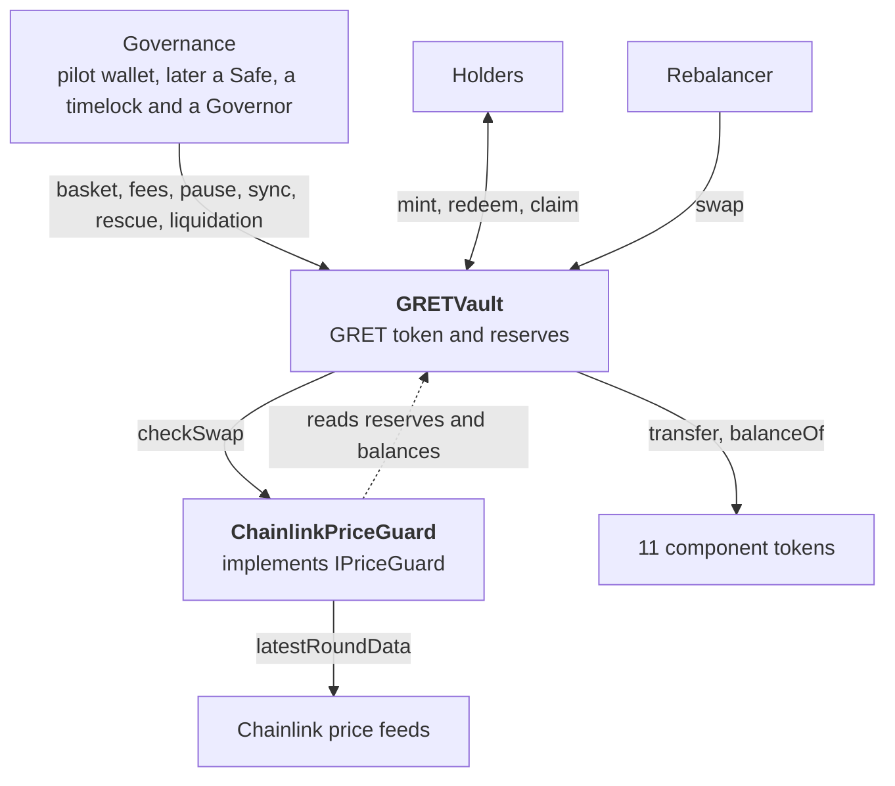

# GRET contracts

[](https://github.com/global-reserve/gret-contracts/actions/workflows/ci.yml)
[](LICENSE)
[](https://docs.soliditylang.org/en/v0.8.38/)

Smart contracts for **Global Reserve Token (GRET)**: an ERC-20 share of a basket of tokenized
assets on Ethereum, minted and redeemed in kind.

**[Website](https://grt.finance)** · **[Guide (PDF)](docs/GRETVault-explained.pdf)** ·
[Specification](docs/SPECIFICATION.md) · [Accepted risks](docs/ACCEPTED_RISKS.md)

> [!WARNING]
> **Not deployed and not independently audited.** A mainnet pilot with the project's own funds
> is prepared and rehearsed. Nothing in this repository is an offer to buy or sell any asset,
> nor investment advice. Use it at your own risk.

## Overview

- **One contract, one token.** `GRETVault` is both the GRET ERC-20 and the vault that holds
  the basket: 11 tokenized assets, from equity, Treasury, credit, real-estate and commodity
  funds to gold and bitcoin.
- **In kind, without prices.** A mint deposits every component in proportion to the reserves
  and a redemption pays them out. No oracle takes part in either.
- **Immutable.** No upgrades and no owner. Governance acts within limits the code enforces:
  new components, rebalancers, price guards, write-offs, fee raises and governance handovers
  wait 7 days in public; fees are capped at 5%; redemption can never be paused.
- **Bounded rebalancing.** A rebalancer exchanges one component for another, and every swap
  must pass a price guard. `ChainlinkPriceGuard` refuses a swap that loses more than 2%, or
  one that would take more than 2% of the vault's value in a week.
- **An exit for everyone.** Governance can start an irreversible liquidation in which every
  holder withdraws each component on its own, even if others fail.

## Architecture



Only `GRETVault` holds funds. The price guard can only refuse a swap. Governance and the
rebalancer are addresses to the vault, so what stands behind them can change without
touching it. The [guide](docs/GRETVault-explained.pdf) has a diagram of every contract
involved.

| Contract | Description |
| --- | --- |
| [`GRETVault`](contracts/GRETVault.sol) | The GRET token and the vault: mint, redemption, basket changes, rebalancing, fees and liquidation |
| [`ChainlinkPriceGuard`](contracts/ChainlinkPriceGuard.sol) | The first price guard: values both sides of a swap with Chainlink feeds and enforces the loss limits; no owner, nothing to change |
| [`IPriceGuard`](contracts/IPriceGuard.sol) | The one question the vault asks before every swap |

## Documentation

| Document | Contents |
| --- | --- |
| [Specification](docs/SPECIFICATION.md) | Design, rules, implementation details, tests and the pilot |
| [Accepted risks](docs/ACCEPTED_RISKS.md) | Every accepted risk with its reason and mitigation, and governance's operating policy |
| [Guide (PDF)](docs/GRETVault-explained.pdf) | How the contracts work, in plain language, with diagrams and examples |
| [Mainnet pilot](docs/PILOT.md) | Steps to deploy the vault and make the first mint |
| [Security policy](SECURITY.md) | How to report a vulnerability |
| [Contributing](CONTRIBUTING.md) | Setup, what to run for each change and conventions |
| [Code of conduct](CODE_OF_CONDUCT.md) | Contributor Covenant 2.1 |

## Deployments

| Network | Contract | Address |
| --- | --- | --- |
| Ethereum mainnet | `GRETVault` | Not deployed yet |

## Getting started

Requires Node.js 24.14.1 (`.nvmrc`) and npm 11.

```sh
nvm use
npm ci
npm run check
npm run demo
```

`check` compiles, type-checks the TypeScript and runs the tests. `demo` deploys, on an
ephemeral local blockchain, 11 mocks with the basket's symbols and decimals plus the vault,
makes the first mint of 1 GRET and prints addresses and reserves. A Hardhat test account
stands in for governance.

## Commands

| Command | Use |
| --- | --- |
| `npm run compile` | Compile Solidity and generate the contract types |
| `npm test` | Run the tests |
| `npm run typecheck` | Compile and type-check TypeScript |
| `npm run check` | Type-check and run the tests |
| `npm run test:coverage` | Run the tests with coverage |
| `npm run test:deep` | Long fuzz and invariant runs (about 2 minutes) |
| `npm run test:fork` | Test the vault with the 11 real components on a mainnet fork |
| `npm run pilot:rehearse` | Rehearse the pilot on a mainnet fork with the pilot wallet |
| `npm run pilot:fork-node` | Local mainnet fork at `127.0.0.1:8545`, to rehearse with MetaMask |
| `npm run pilot` | Local pilot page at `127.0.0.1:8787`, to sign with MetaMask |
| `npm run node` | Start a local node at `127.0.0.1:8545` |
| `npm run deploy:local` | Deploy the mocks and the vault on that node |
| `npm run demo` | Deploy the mocks and the vault on an ephemeral local network |
| `npm run clean` | Remove Hardhat artifacts |

`test:fork` needs `MAINNET_RPC_URL`. Without `MAINNET_FORK_BLOCK` it uses the latest block
and prints which one; pinning a block requires an RPC with historical state. For example:

```sh
MAINNET_RPC_URL=https://ethereum-rpc.publicnode.com npm run test:fork
```

The mainnet pilot is explained step by step in [`docs/PILOT.md`](docs/PILOT.md).

To keep a local network between runs, leave `npm run node` open in one terminal and run
`npm run deploy:local` in another. Hardhat provides the test accounts; no private keys need
to be configured. The state lasts while the node is running.

## Interface

Functions of `GRETVault`, besides the standard ERC-20 ones:

| Function | Who | What it does |
| --- | --- | --- |
| `mint(shares, maxAmountsIn, minShares, version)` | Anyone | Contributes every component with a reserve in proportion and receives GRET, minus the mint fee; the first mint issues exactly 1 GRET |
| `redeem(shares, minAmountsOut, version)` | Wallets that minted | Pays the redemption fee in GRET, burns the rest and receives every component; all or nothing; leaves the supply at 0 or at least 1 GRET |
| `redeemSkipping(shares, minAmountsOut, skipped, version)` | Wallets that minted | Same redemption without the listed components, which are not called; the caller gives up its share of them |
| `recognizeLoss(i)` | Anyone | Lowers the reserve of component `i` to its actual balance when that is lower; mint and redemption do it on their own |
| `convertToClaims(shares)` | Any holder | During liquidation, burns GRET in exchange for per-component rights |
| `claim(i, to, minAmount)` | Whoever converted | Withdraws the pending right over component `i` |
| `activateLiquidation()` | Governance | Irreversible liquidation: closes mint and normal redemption |
| `sync(token)` | Governance | Adds the surplus of that component to the reserve, for the benefit of holders; also during liquidation |
| `rescue(token, to, amount)` | Governance | Withdraws tokens outside the basket, or a component's surplus |
| `proposeGovernance(next)` / `cancelGovernanceProposal()` | Governance | Proposes or discards the next governance |
| `acceptGovernance()` | Proposed governance | Takes over the role, 7 to 14 days after the proposal |
| `swap(sell, sellAmount, buy, buyAmount)` | Rebalancer | Delivers `buyAmount` of one component and takes `sellAmount` of another's reserve; the price guard must accept it |
| `proposeRebalancer(next)` / `cancelRebalancerProposal()` / `revokeRebalancer()` | Governance | Proposes or discards the next rebalancer, or removes the current and pending ones at once |
| `acceptRebalancer()` | Proposed rebalancer | Takes over the role, 7 to 14 days after the proposal; there is none at deployment |
| `proposePriceGuard(guard)` / `cancelPriceGuardProposal()` | Governance | Proposes or discards the contract that must accept every swap |
| `applyPriceGuard()` | Anyone | Applies the proposed guard, 7 to 14 days after the proposal; there is none at deployment, and without one there are no swaps |
| `announceComponent(token)` / `cancelComponentAnnouncement(token)` | Governance | Announces or discards a new component |
| `addComponent(token)` | Anyone | Adds an announced component, 7 to 14 days later, with no reserve |
| `removeComponent(token)` | Governance | Removes a component with no reserve, never a written-off one; the later ones move down one index |
| `setMintPaused(paused)` | Governance | Pauses or resumes minting at once; redemption is never paused |
| `setInitialAmounts(amounts, version)` | Governance | Sets the basket of the first mint, used only while the supply is zero |
| `proposeWriteOff(token)` / `cancelWriteOff(token)` | Governance | Proposes or discards writing off a component that stopped working; governance judges it |
| `writeOffComponent(token)` | Anyone | 7 to 14 days later, drops its reserve to zero; the token stays in the basket and can never be rescued |
| `proposeFees(mintFee, redeemFee)` / `cancelFeesProposal()` | Governance | Sets the fees in basis points, at most 5% each: a cut applies at once, a raise waits 7 days |
| `applyFees()` | Anyone | Applies a proposed raise, 7 to 14 days after it |
| `setFeeRecipient(recipient)` | Governance | Chooses who receives the fees, in GRET |

Governance is an external contract; GRET does not vote. A proposal that waited 7 days expires if
nobody executes or accepts it in the following 7 days (`EXECUTION_WINDOW`). Amounts per GRET are not stored: they
follow the reserves, so rebalancing means swapping what the vault holds. The vault rejects
GRET sent to its own address. The views `previewMint`, `previewRedeem`, `reserves`, `componentSurplus`,
`pendingRights` and `claimable` compute amounts before operating.

`ChainlinkPriceGuard` is the first price guard. It values both sides of each swap with one
Chainlink feed per token and refuses a token without a fresh price, a swap that loses more
than 2% of what the vault sells, and swaps that would take more than 2% of the vault's value in
a week, each loss measured against the vault's value at that moment. It has
no owner: its feeds and limits are fixed at deployment, and changing them means appointing
another guard with the 7-day wait. Mint, redemption and liquidation never call it. The
proposed feeds are `PRICE_FEEDS` in `scripts/pilot/config.ts`; six of the 11 components have
no Ethereum feed and cannot be swapped.

Arrays of amounts follow the order of `components()`. `version` is the `basketVersion()` they
were prepared for: it grows with every addition or removal, and a call prepared for another
basket reverts with `BasketChanged` instead of applying a limit to another token.

## Repository layout

```text
contracts/GRETVault.sol              GRET token and vault: mint, redemption, sync, rebalancing and liquidation
contracts/IPriceGuard.sol            What the vault asks the price guard in every swap
contracts/ChainlinkPriceGuard.sol    Price guard with Chainlink feeds and loss limits per swap and per week
contracts/mocks/MockAggregator.sol   Test Chainlink feed with a price set by hand
contracts/mocks/MockPriceGuard.sol   Test guard that accepts every swap unless told to refuse
contracts/mocks/MockERC20.sol        Test ERC-20 with configurable decimals
contracts/mocks/MockFaultyERC20.sol  Test ERC-20 with switchable faults
contracts/mocks/MockNoReturnERC20.sol Test token without a return value, like USDT
test/GRETVault.ts                    Setup, bootstrap, mint, redemption, losses and sync
test/GRETVault.liquidation.ts        Activation, conversion and claims with failing components
test/GRETVault.governance.ts         Rescues, governance limits and governance transfer
test/GRETVault.timelock.ts           Governance that evolves with OpenZeppelin's TimelockController
test/GRETVault.rebalancing.ts        Rebalancer, price guard, swaps, adding, removing and writing off components
test/ChainlinkPriceGuard.ts          Chainlink price guard: prices and loss limits
test/ChainlinkPriceGuard.fuzz.t.sol  Fuzzing of the weekly loss limit
test/GRETVault.fees.ts               Mint and redemption fees
test/GRETVault.adversarial.ts        Reentrancy, non-standard tokens and issuer actions
test/GRETVault.protections.t.sol     Attacks and failures the vault refuses or lets holders get around
test/GRETVault.risks.t.sol           One case per accepted risk, named after its ID
test/GRETVault.fuzz.t.sol            Property fuzzing in Solidity
test/GRETVault.invariant.t.sol       Invariants over random sequences of every operation
test/GRETVault.invariants.ts         Deterministic random sequences with invariants
test/MockERC20.ts                    Tests of the mocks with 18 and 8 decimals
test/helpers/basket.ts               Test basket shared by the vault tests
test/helpers/GRETVaultCase.sol       Setup and adverse tokens shared by the Solidity cases
test-fork/GRETVault.mainnet.ts       Vault, rebalancing and price guard with the real components and feeds on a mainnet fork
test-fork/GRETVault.pilot.ts         Pilot rehearsal with the real wallet on a mainnet fork
scripts/deploy-local.ts              Local deployment of 11 mocks and the vault
scripts/pilot/config.ts              Mainnet pilot parameters
scripts/pilot/plan.ts                Pilot transactions and checks
scripts/pilot/server.ts, index.html  Local page to sign the pilot with MetaMask
hardhat.config.ts                    Compiler, plugins and local networks
docs/SPECIFICATION.md                Specification: design, rules, implementation details, tests and the pilot
docs/ACCEPTED_RISKS.md               Accepted risks, their reasons and governance's operating policy
docs/GRETVault-explained.pdf, .html  Plain-language guide to the contracts (PDF and its HTML source)
docs/PILOT.md                        Mainnet pilot guide
.github/workflows/ci.yml             Continuous integration: compile, type-check and test
CONTRIBUTING.md                      Setup, what to run for each change and conventions
CODE_OF_CONDUCT.md                   Contributor Covenant 2.1
.github/ISSUE_TEMPLATE/              Bug report and proposal forms; security reports go private
.github/pull_request_template.md     Pull request checklist
SECURITY.md                          How to report a vulnerability
```

The mocks start with zero supply and let anyone call `mint` to set up test scenarios.
`MockFaultyERC20` can revert or return `false` on transfers, revert on `balanceOf`, charge a
fee, deliver 1 wei less, reject zero transfers, block addresses, remove balance or reenter
the vault. They do not represent the real tokens or their issuer restrictions.

## Development notes

- Node.js **24.14.1** (`.nvmrc`) and npm **11.11.0**.
- Hardhat **3.18.0**, TypeScript ESM, viem and `node:test`.
- Solidity **0.8.38**, EVM Cancun, optimizer with 200 runs.
- OpenZeppelin Contracts **5.6.1** for the vault and the ERC-20 mocks.
- forge-std **1.17.0** for the Solidity fuzz and invariant tests.

Direct dependencies use exact versions and `package-lock.json` pins the whole tree. The
`solc` compiler is installed from npm and Hardhat loads it locally; once installed,
compiling and running the local tests needs neither an RPC nor another compiler download.

`package.json` pins `solc > tmp` to **0.2.7** to fix advisory
[GHSA-7c78-jf6q-g5cm](https://github.com/advisories/GHSA-7c78-jf6q-g5cm) in version 0.2.6,
which `solc` pulls in. Review this override when upgrading the compiler.

`hardhat.config.ts` also compiles OpenZeppelin's `TimelockController` (`npmFilesToBuild`)
for the governance integration tests; it is not part of the vault.

When compiling, `solc` prints a generic warning about transient storage (EIP-1153). It
comes from OpenZeppelin's `ReentrancyGuardTransient`. The warning itself states that using
it for reentrancy guards that are cleared at the end of the call is safe.

## Security

The contracts have had internal reviews, not an independent audit. Report vulnerabilities
privately as described in [SECURITY.md](SECURITY.md); the risks that were consciously
accepted are in [docs/ACCEPTED_RISKS.md](docs/ACCEPTED_RISKS.md).

## License

MIT; see [LICENSE](LICENSE).
